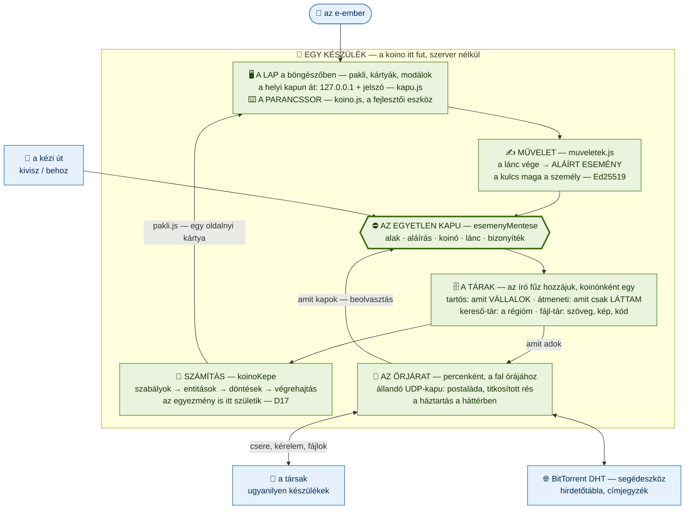
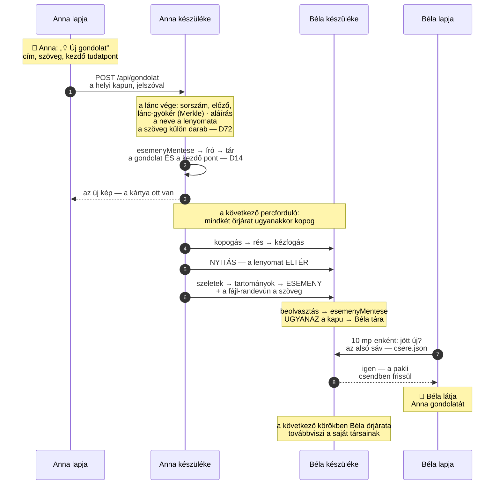
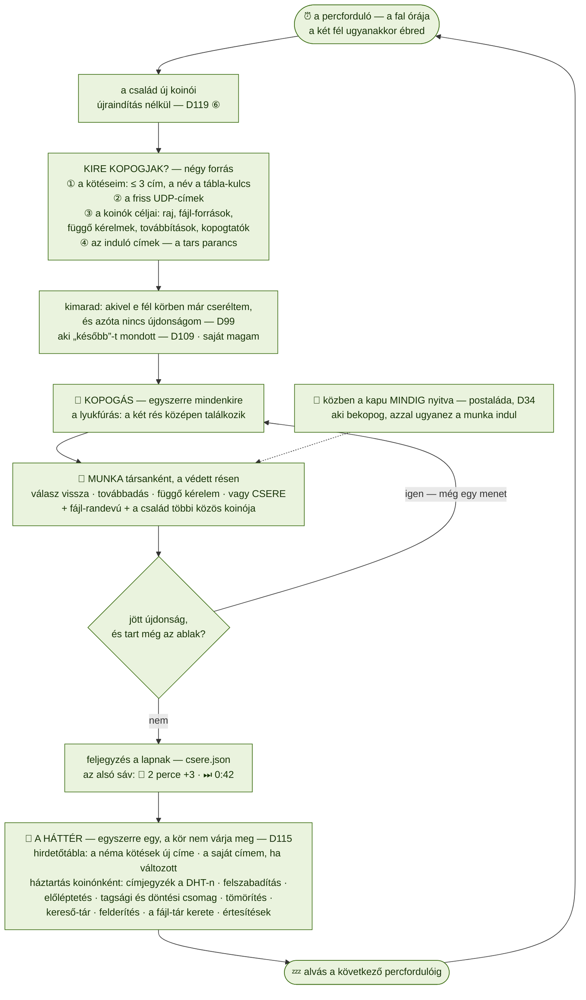
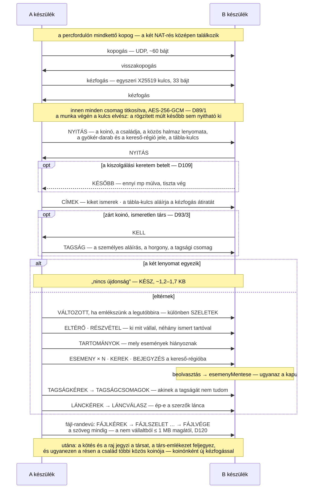
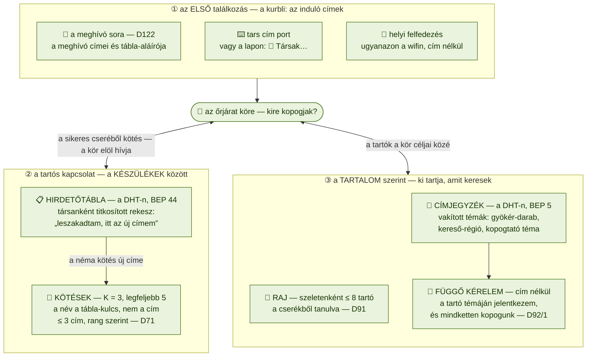
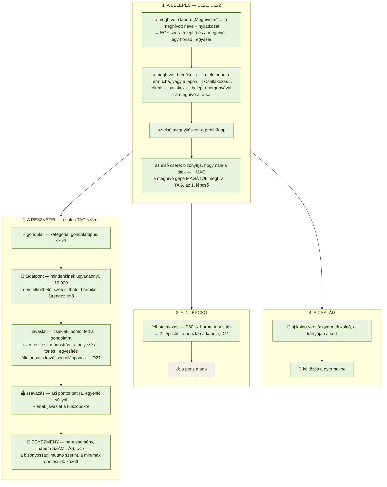
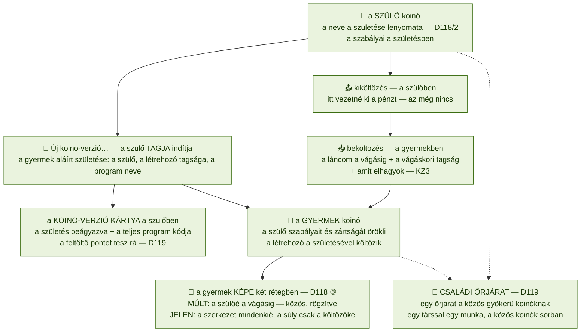
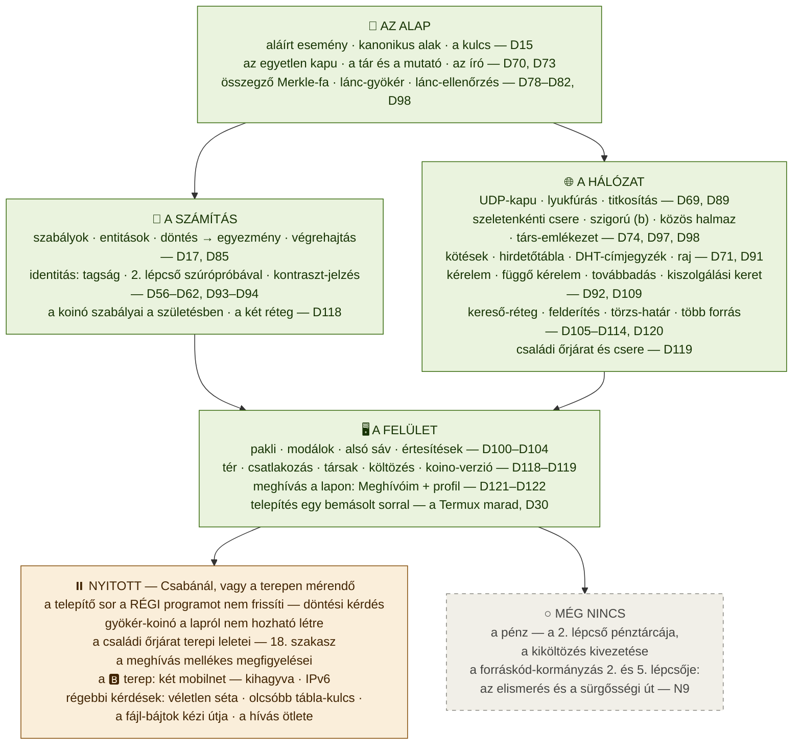

# A koino programja — folyamatábrák a tervezéshez

*Létrehozva: 2026-11-04, Csaba kérésére: „tudsz készíteni egy folyamat ábrát a programról, a tervezéshez?”*

> **Mi ez a dokumentum?** Az ÚJ program (`koino/` — a P2P koino) **működése képekben**: mi fut egy
> készüléken, merre megy egy esemény, mit csinál az őrjárat egy körben, hogyan beszél két készülék,
> hogyan találják meg egymást, mi az e-ember útja, mi a koinó családja — és a tervezéshez: **mi kész,
> mi nyitott, mi nincs még** (8. ábra).
>
> A [`gepezet.md`](gepezet.md) testvére: az a **döntés-gépezet** képei (javaslat → egyezmény, a
> tudatpont útja), ez a **program** egésze. A képek `mermaid` alakban vannak, mint ott: a GitHub és a
> legtöbb szerkesztő rendereli, a nyers szöveg olvasható marad — nulla függőség (6. szabály).
>
> ⚠️ **Az állapot 2026-11-04-i** (a D122 után, 1366 önpróba). Ha egy pillér változik, a képet is
> javítani kell — *a képet javítva vitatjuk meg, nem a szöveget.*

**A színek — minden ábrán ugyanazok:** zöld = **kész** és próbákkal őrzött · sárga = **nyitott**
(Csabánál, vagy a terepen mérendő) · szürke, szaggatott keret = **még nincs** · kék = **kívül** (az
e-ember, a társak, a DHT, a fájl).

**Az ábrák:** 1. A nagy kép · 2. Egy esemény útja · 3. Az őrjárat köre · 4. Egy csere · 5. Hogyan
találják meg egymást · 6. Az e-ember útja · 7. A koinó családja · 8. ⭐ Hol tartunk — a tervezés térképe

**Hogyan használd a tervezéshez:** egy új lépésnél keresd meg a dobozát (a 8. ábrán), és nézd meg,
mire épül és mi épül rá — a nyilak a függőséget mutatják. A doboz D-száma a
[`fejlesztesi_terv_fazis2.md`](fejlesztesi_terv_fazis2.md)-ben, az elágazás az
[`alappillerek.md`](alappillerek.md) 5. szakaszában. Ha a lépés egy KÖZÖS réteget érint (az esemény
alakja, a kapu, a tár, a szabály-réteg — az 1. ábra közepe), a végén a teljes próbasor kell.

---

## 1. A NAGY KÉP — egy készülék és a világ

Nincs szerver: **minden a készüléken fut**, két hosszan futó folyamatban — a **felület** (`koino
felulet`: a lap és a helyi kapu) és az **őrjárat** (`koino orjarat`: a csere a társakkal). A telefonon
a `koino` indító (`koino/termux/indit.sh`) mindkettőt elindítja. Ami közös bennük: **egy kapu** és
**egy tár**.

- **Két bejárat, egy út.** A lap és a parancssor ugyanazt a műveletet hívja (`muveletek.js`), és a
  művelet egy ALÁÍRT eseményt ad. „Módosít” és „töröl” nincs, csak hozzáfűzés — a változás is egy új
  esemény.
- **Egy kapu mindenre (3. szabály).** A saját műveletem, a társtól jött esemény (`beolvasztas`), a
  kérelem válasza és a fájlból behozott mind az `esemenyMentese`-n megy át. *A hálózat nem kap
  engedékenyebb kaput.*
- **Négy tár.** A tartósban az van, amit VÁLLALOK (amire pontot tettem, a saját azonosságom, a koinó
  születése — `vallalas.js`, D75), az átmenetiben, amit csak LÁTTAM (eldobható, ≤ 20 MB), a kereső-tár
  a megtalálhatóság puha állapota (D107 L1), a fájl-tár a szövegek, képek és a kód tartalom-címzett
  tára.
- **Az állapot nem tárolt, hanem számított (D17).** A lap, a parancssor és a művelet ugyanazt a képet
  számolja (`ketReteg.js` `koinoKepe`) — ezért mond ugyanazt. A lap soha nem kap „mindent”: a pakli
  egy oldalnyi kártyát ad (5.2).
- **Az író (D70).** Egy készüléken több folyamat dolgozik, de koinónként csak egy fűz a tárhoz; a többi
  az aláírt eseményt átadja neki.
- **Ami kívül van, az segédeszköz (2. és 4. szabály).** A DHT nélkül is megy a koino (csak a leszakadt
  társ visszatalálása lassul), és a kézi út hálózat nélkül is.

---

## 2. EGY ESEMÉNY ÚTJA — a kattintástól a másik lapjáig

Anna egy gondolatot ír; Béla ugyanannak a koinónak a tagja, egy másik készüléken. *(A „készülék” itt a
felület és az őrjárat együtt — a két folyamat ugyanazt a kaput és tárat használja.)*

- ⭐ **Ha Béla nem tartja ezt az ágat.** A szigorú (b) óta (D97) egy készülék csak a VÁLLALT szeleteiben
  vesz részt a cserében. A gondolat születése a szülőjénél (a legfelső szintűé a gyökér-darabban) be
  van jelentve (`bejelentesHelyei`), tehát aki azt tartja, a cserében megkapja. Ha Béla semmit nem tart
  belőle, a 7–9. lépés helyett a lapja **kérelmet** ad, amikor a kártyát mutatná (fejlécek, szelet,
  törzs — D92), és a válasz az **átmeneti tárba** kerül.
- A hálózaton minden titkosítva megy (D89/1), de **a bizalom nem a csatornából jön**: Béla gépe az
  aláírást, a láncot és a bizonyítékot maga ellenőrzi.
- A tudatpont, a javaslat és a szavazat ugyanígy utazik; a döntés mindkét gépen ugyanabból az
  eseményhalmazból **számolódik** — senki nem „hirdeti ki” (D17).

---

## 3. AZ ŐRJÁRAT KÖRE — minden ablakban

A kör hossza beállítható (`koino orjarat [perc] [port]` — a telefonon az indító alapból percenként
futtatja). A kör mindig a fal órájához igazodik: az epoch szerinti percfordulóhoz.

- ⭐ **Miért a fal órája?** Rést csak az EGYIDEJŰ kopogás nyit, ezért mindenki ugyanahhoz a külső
  ponthoz igazodik — megbeszélés és jelzőpont nélkül. A 30. mérés szerint ritka hálón ez a működés
  feltétele, nem gyorsítás.
- **Az ismétlés.** Egy menetben a hír egy lépést tesz; amíg jön újdonság, a kör újra kopog azokra,
  akikkel a munka sikerült — az ablak végéig (a „buli”).
- **A háttér nem tartja fel a kopogást (D115, 80. mérés).** Ami egyidejűséget kíván (a kopogás), az az
  óra szerint megy; ami nem (a DHT, a takarítás), az ráér.
- **Nem folyamatos kapcsolat (5. szabály).** A kör végén minden elenged, a készülék alszik a következő
  ablakig — de a kapu nyitva marad, mint egy postaláda.

---

## 4. EGY CSERE — két készülék a résen

A párbeszéd **szimmetrikus** (`vonal.js` `parbeszed` mindkét oldalon fut): kliens és szerver nincs, a
két fél ugyanazt mondja. Az ábra az egyik irányt rajzolja.

- **A csere helyett jöhet KÉRELEM is** (D92 — „add ide ezt”): a nyitás helyett `KERELEM`, és a válasz
  szelet (`ESEMENY` × N), fejlécek (`FEJLECEK` → `MINTAKEREK` → `MINTAK` — a szúrópróba), törzs
  (`TORZS` → a fájlok), keresés vagy felajánlás. Ha egy munkában mindkét fél kérne, a kisebbik megy
  elöl, a másik kiszolgálja (az ütközés — a ⑦ terepi lelete).
- **A két szint:** előbb a SZELETEK lenyomatai (melyik szelet tér el), aztán csak az eltérőkben a
  TARTOMÁNYOK (mely események) — a forgalom az eltérések számától függ, nem a koinó méretétől (D74).
- **A társ-emlékezet (F, D98/1):** ha mindkét fél emlékszik a legutóbbi cseréjükre, az első szint
  elmarad, és csak az azóta változott szeletek mennek (70. mérés).

---

## 5. HOGYAN TALÁLJÁK MEG EGYMÁST

- **A cím elromlik, a kötés nem.** A mobilnet és a wifi gyakran vált címet (31. mérés: a leképezés
  percek alatt elhal), ezért a kötés a társ TÁBLA-KULCSÁT jegyzi — ami soha nem az azonosságod (D6) —,
  és ha a társ elnémul, a hirdetőtábláról olvassa ki az új címét. *(35. mérés: hirdetőtábla nélkül a
  kötés-háló egy nap alatt szétesik, vele ~1% szakad le.)*
- **A tartalom útja külön van.** A raj és a címjegyzék azt mondja meg, ki TARTJA azt a szeletet, amit
  keresek („mi kinél van” — D84/2, D91). A téma vakított: kívülálló nem tudja kiszámolni, hol keresse.
- **Két NAT között a függő kérelem.** Ha a tartónak nincs ismert címe, a kérő a tartó készülékének
  kopogtató témáján jelentkezik; a tartó őrjárata ezt látja, és a következő ablakban mindketten
  kopognak (60. mérés: 20% → 76%).
- ⚠️ **Mindez a MEGTALÁLÁS** — ami DÖNT valamiről, az soha nem kíván élő lekérdezést.

---

## 6. AZ E-EMBER ÚTJA — a meghívótól az egyezményig

- **Egy meghívó elég az 1. lépcsőhöz (D56):** a tagsággal minden mehet — gondolat, tudatpont,
  javaslat, szavazat. A nem tag eseménye nem vész el, csak „függőben” van, amíg a tagsága nem
  bizonyítható (D19, D93/1).
- **A 2. lépcső drága, mert ott a zsákmány:** három tanúsítás felhatalmazott tanúsítótól. A számítása
  kész (szúrópróbával is — D94), a **pénz maga még nincs** a programban.
- **A sorrend a tudatpont felől:** javaslatot csak az tesz, akinek pontja van a gondolaton; a döntés a
  pontosok köréből, a küszöbök a tulajdonosok érték javaslatainak mediánjából jönnek (a részletek a
  [`gepezet.md`](gepezet.md) 1–4. ábráján).

---

## 7. A KOINÓ CSALÁDJA — gyermek, költözés, családi őrjárat

- ⭐ **A múlt közös, a jelenlét személyes (D118).** A gyermek a szülőre épül — a szülő eseményei a
  vágásig átírás nélkül, az entitások a régi nevükön —, de a gyermekben súlyt csak az hoz, aki
  beköltözött. A lezárt döntés múlt; a nyitott a költözőkkel folytatódik.
- **A gyermek a kódot is magával hozza (D119 ①).** A koino-verzió kártya „Kód” fülén a teljes program; a
  lap kimondja, ha a készülék más verziót futtat. *(Ez a forráskód-kormányzás 2. szintje — a
  [`kormanyzas.md`](kormanyzas.md).)*
- **A családot egy őrjárat cseréli (D119 ③–④).** A közös gyökerű koinók egy munkában mennek, társanként;
  a független koinók külön családok maradnak (⑤ — külön kötés-jegyzék, külön tábla-rekesz).

---

## 8. ⭐ HOL TARTUNK — a tervezés térképe

A program rétegei a mai állapotukkal, és a nyitott ágak: **honnan indulhat a következő lépés.** A
nyilak a függőséget mutatják (amire épül). A részletek a [`CLAUDE.md`](../CLAUDE.md) „HOL TARTUNK”
szakaszában és az [`alappillerek.md`](alappillerek.md)-ben.

**A nyitott ágak, egy mondatban mindegyik** (hol a részlet):

- **A régi program frissítése** — a telepítő sor egy már telepített, régebbi programot NEM frissít, és a
  régi kód az új meghívót nem fogadja el; hogy frissítsen-e, az döntési kérdés (D119: a program nem
  frissül magától). → [`meghivas_atvizsgalas.md`](meghivas_atvizsgalas.md) 8. szakasz.
- **Gyökér-koinó a lapról** — gyermeket már lehet a lapról (a fő menü „🧬 Új koino-verzió…”), de egy
  független, új koinót csak a `koino "<név>"` parancs hoz létre.
- **A családi őrjárat terepi leletei** (2026-11-01) — a többi között: a DHT-n a vakított témáinkon
  idegen címek is jelentkeznek, és a kör rájuk is kopog (~0,9 MB/nap); a jegyzetlen becenévvel a program
  csendben üres, régi alakú koinót indít; a lap a megjegyzett entitást a rossz koinóban kéri; és a „⚠ más
  programverzió” minden frissítés után megjelenik. → [`csaladi_orjarat_atvizsgalas.md`](csaladi_orjarat_atvizsgalas.md)
  18. szakasz, „Még nyitott leletek”.
- **A meghívás mellékes megfigyelései** (2026-11-04) — az üres koinó alapítójának lapja is „a hiányzó
  részek tartóit még keresem”-et ír, és a meghívó címei közé a gép virtuális hálókártyájáé is bekerül.
  → [`meghivas_atvizsgalas.md`](meghivas_atvizsgalas.md) 8. szakasz vége.
- **A terep 🅱️** (két mobilnetes telefon — Csaba: „ezt hagyjuk ki”) és **az IPv6** (egy második út a két
  mobilnet közé; az értéke a terepen derülne ki).
- **Régebbi döntések** — a véletlen séta, az olcsóbb tábla-kulcs, a fájl-bájtok kézi útja, a hívás
  ötlete: a [`CLAUDE.md`](../CLAUDE.md) „Régebbi nyitott döntések” listája.
- **Ami még nincs:** a **pénz** (a 2. lépcső számítása kész, a pénztárca maga nem — a kiköltözés lesz a
  kivezetés helye), és a forráskód-kormányzás **elismerés-** és **sürgősségi** lépcsője (N9 — a
  [`kormanyzas.md`](kormanyzas.md) „Az öt lépcső”).

⚠️ *A kisebb, mérendő ügyek (az időzítés-érzékeny próbák egyszeri bukásai, a „még nem jött meg” felirat
a hiányzó szövegnél) nem kerültek az ábrára — a [`CLAUDE.md`](../CLAUDE.md) „Kisebb nyitottak”
blokkjaiban állnak.*
